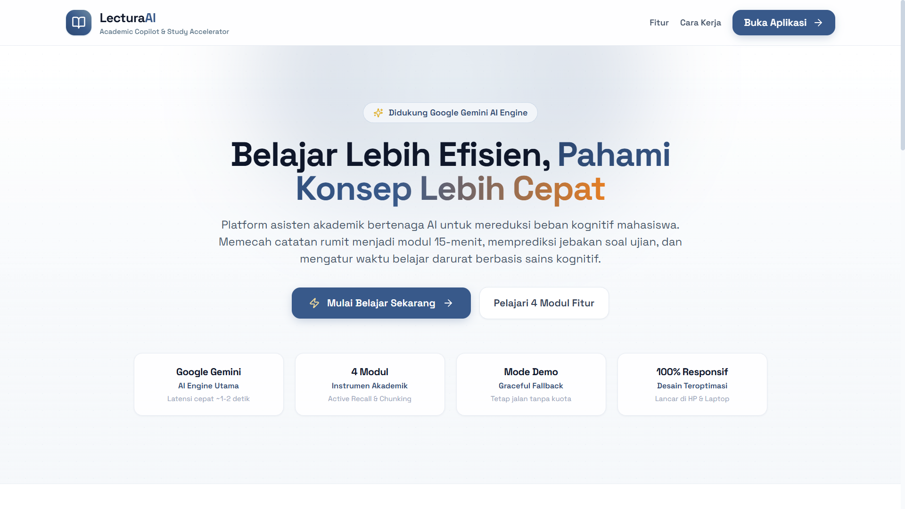
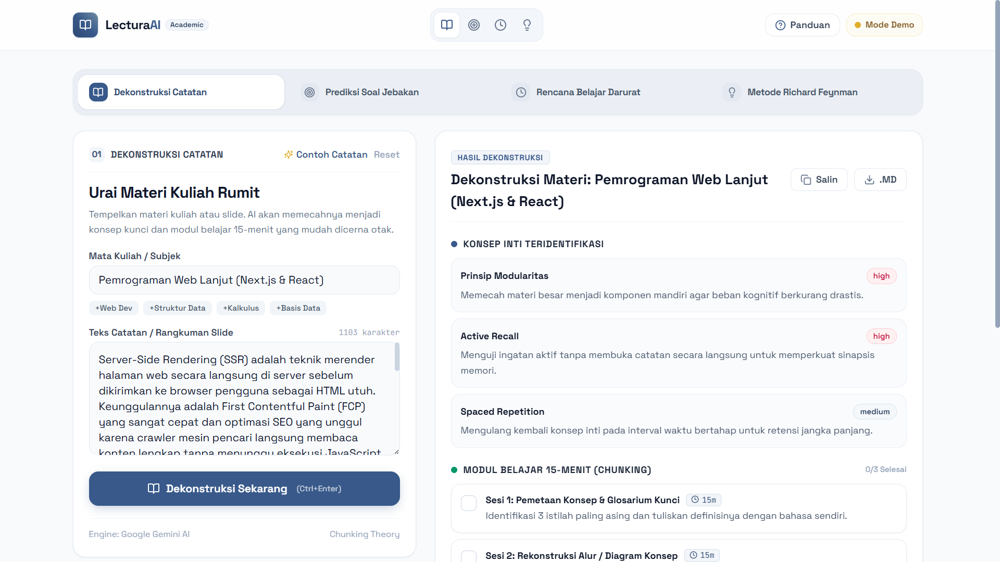

# 🎓 Lectura AI — Modern Academic Copilot & Cognitive Learning Engine

> **Platform AI Copilot akademik modern berbasis riset kognitif untuk mendekomposisi materi perkuliahan, memprediksi jebakan soal ujian dosen, menyusun rencana belajar 24 jam berbasis Pareto 80/20, dan menyederhanakan teori kompleks menggunakan metode Richard Feynman.**

---

[](https://nextjs.org/)
[](https://www.typescriptlang.org/)
[](https://tailwindcss.com/)
[](https://greensock.com/gsap/)
[](https://aistudio.google.com/)
[](https://zod.dev/)
[](LICENSE)

---

## 📸 Antarmuka & Cuplikan Layar (Screenshots)

### 1. Landing Page — Presentasi & Navigasi Interaktif

*Tampilan Landing Page dengan Academic App Color Palette (Chambray, Bermuda Gray, Pigeon Post, Ronchi, dan Zest), tipografi Space Grotesk, dan animasi entrance GSAP yang halus.*

### 2. Workspace Aplikasi & Fitur Modul

*Workspace terfokus dengan bilah Segmented Control yang ramping, ramah layar ponsel/desktop (anti-cluttered), serta komparasi analisis instan.*

---

## 🌟 Mengapa Lectura AI?

Perkuliahan dan persiapan ujian seringkali menimbulkan hambatan belajar:
1. **Information & Cognitive Overload**: Catatan tebal puluhan lembar dan slide presentasi padat yang melelahkan jika dibaca ulang tanpa struktur.
2. **Soal Jebakan Dosen (*Exam Traps*)**: Pertanyaan mengecoh (*edge cases* / trik logika) yang sering menggugurkan nilai mahasiswa saat ujian.
3. **Kepanikan H-1 Ujian (&lt; 24 Jam)**: Belajar sistem kebut semalam (SKS) yang tidak terarah dan berisiko memicu kelelahan otak (*burnout*).

**Lectura AI** memecahkan masalah tersebut dengan menyatukan metodologi psikologi kognitif teruji ke dalam 4 modul cerdas.

---

## ⚡ 4 Modul Unggulan (Core Instruments)

| Modul | Teori / Metodologi | Fungsi Utama |
| :--- | :--- | :--- |
| **01. Dekonstruksi Catatan** | *Chunking Theory* (George A. Miller) | Memecah teks tebal menjadi konsep kunci berbobot dan modul belajar 15-menit dengan checklist progres. Ekspor hasil ke Markdown (.md). |
| **02. Prediksi Soal Jebakan** | *Error-Driven Learning* & *Examiner Mindset* | Memetakan sudut pandang pembuat soal (dosen), mendeteksi jebakan kondisi batas (*edge cases*), dan menyajikan kunci pembenarannya. |
| **03. Rencana Belajar 24-Jam** | *Prinsip Pareto 80/20 & Sleep Consolidation* | Mengalokasikan 20% topik vital penentu 80% nilai ujian, membagi jadwal jam demi jam berdasarkan energi kognitif, serta jadwal istirahat wajib. |
| **04. Metode Richard Feynman** | *Mental Models & Analogy Learning* | Menjelaskan rumus atau teori abstrak menjadi analogi dunia nyata tanpa jargon teknis, lengkap dengan kuis uji pemahaman mandiri. |

---

## 🎨 Identitas Desain & UI/UX

* **Academic App Color Palette**:
  * **Chambray (`#38598a`)**: Warna primer berkarakter akademis elegan untuk aksi utama dan identitas brand.
  * **Bermuda Gray (`#718da2`)**: Aksen sekunder untuk badge dan garis pembatas.
  * **Pigeon Post (`#a7c4d7`)**: Latar belakang lembut untuk modul kartu.
  * **Ronchi (`#f0c74c`)**: Aksen emas hangat untuk sorotan dan indikator darurat.
  * **Zest (`#e57e24`)**: Aksen kontras berenergi tinggi untuk penanda jebakan ujian.
* **Tipografi Modern**: **Space Grotesk** (geometrik akademis) + **JetBrains Mono** (kode & metrik waktu).
* **Animasi Ringan (GSAP)**: Transisi mulus yang menghormati preferensi aksesibilitas `prefers-reduced-motion`.
* **Mobile-First & Anti-Cluttered**: Segmented Control Bar hemat ruang yang mendukung *horizontal scroll* pada layar ponsel tanpa menutupi area formulir kerja.

---

## 🛠️ Arsitektur & Struktur Folder

```
lectura-ai/
├── app/
│   ├── api/
│   │   ├── deconstruct/route.ts      # Endpoint Dekonstruksi Catatan
│   │   ├── trap-predictor/route.ts   # Endpoint Prediksi Soal Jebakan
│   │   ├── cram-plan/route.ts        # Endpoint Rencana Belajar 24 Jam
│   │   ├── feynman/route.ts          # Endpoint Metode Feynman
│   │   └── status/route.ts           # Endpoint Diagnostik Live API & Fallback
│   ├── components/
│   │   ├── LandingPage.tsx           # Halaman pembuka publik beranimasi GSAP
│   │   ├── Header.tsx                # Bilah navigasi + status modal koneksi AI
│   │   ├── HeroSection.tsx           # Segmented Control Bar switcher modul
│   │   ├── NoteDeconstructor.tsx     # Modul 01: Dekonstruksi Catatan
│   │   ├── TrapPredictor.tsx         # Modul 02: Prediksi Soal Jebakan
│   │   ├── CramPlan.tsx              # Modul 03: Rencana Belajar Darurat
│   │   ├── FeynmanExplainer.tsx      # Modul 04: Analogi Feynman
│   │   ├── OnboardingModal.tsx       # Panduan interaktif 4-langkah pengguna baru
│   │   └── Footer.tsx                # Footer minimalis & status sistem
│   ├── globals.css                   # Custom scrollbar & styling dasar
│   ├── layout.tsx                    # Google Fonts & konfigurasi SEO Metadata
│   └── page.tsx                      # Main single-page interactive controller
├── lib/
│   ├── gemini.ts                     # REST client v1beta + multi-model fallback
│   ├── security.ts                   # Input sanitizer & Zod security validation
│   └── types.ts                      # Definisi tipe data TypeScript
├── public/
│   ├── favicon.svg                   # Favicon SVG beresolusi tinggi (Academic Palette)
│   ├── landing-page.png              # Cuplikan layar halaman depan
│   └── usage-example.png             # Cuplikan layar antarmuka dashboard
└── tailwind.config.js                # Definisi palet warna Academic & bayangan kustom
```

* **Core Engine**: Google Generative Language REST API (`v1beta`).
* **Active Model**: `gemini-3-flash-preview` dengan sistem auto-fallback (`gemini-3.1-flash-lite`, `gemini-3.5-flash`) untuk menjamin kelancaran respons.
* **Graceful Fallback Mode**: Aplikasi tetap dapat mendemokan hasil terkurasi berkualitas tinggi meskipun koneksi internet terputus atau kuota API belum terpasang.

---

## 🚀 Panduan Menjalankan Aplikasi

### 1. Klon Repositori
```bash
git clone https://github.com/syubidin/lectura-ai.git
cd lectura-ai
```

### 2. Pasang Dependensi
```bash
npm install
```

### 3. Konfigurasi Kunci API (Opsional)
Salin `.env.example` menjadi `.env.local`:
```bash
cp .env.example .env.local
```
Masukkan API Key dari [Google AI Studio](https://aistudio.google.com/):
```env
GEMINI_API_KEY=AIzaSyD-kode-api-key-anda-disini
```
*(Jika kunci API tidak diisi, aplikasi akan otomatis beralih ke Mode Demo Cerdas).*

### 4. Jalankan Aplikasi
```bash
npm run dev
```
Buka peramban di [http://localhost:3000](http://localhost:3000).

---

## ⚡ 1-Click Launcher (Windows)
Untuk pengguna awam di lingkungan Windows, cukup klik ganda file **`start-app.bat`**. Skrip otomatis mengecek instalasi Node.js, memasang pustaka dependensi jika belum ada, dan membuka browser secara otomatis.

---

## 👤 Pengembang
* **Nama**: **syubidin**
* **GitHub**: [@syubidin](https://github.com/syubidin)
* **Email**: [syubyattala806@gmail.com](mailto:syubyattala806@gmail.com)

---

## 📄 Lisensi
Didistribusikan di bawah lisensi [MIT License](LICENSE).
